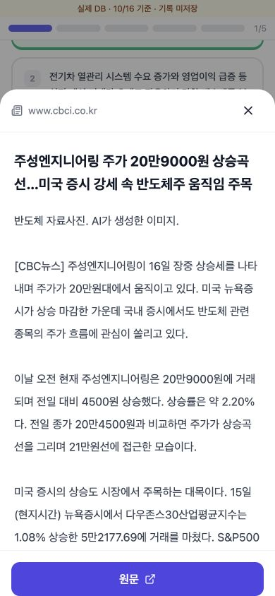
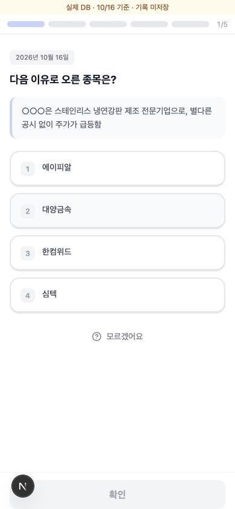
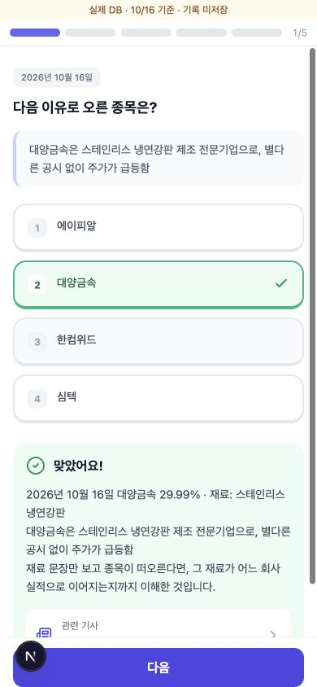

# 매일 퀴즈 실제 시황 연결 검증

검증일: 2026-10-18 (한국 시간)

## 사용한 데이터

오늘 기준으로 DB에 저장된 최신 시황은 **2026-10-16**이다. 10월 18일은 일요일이며, 최신 수집분은 71종목이다. 이 중 상승 이유와 기사 출처가 저장된 종목은 31개다. 기존 출제 로직의 최근 구간 후보는 398개다.

실제 저장 데이터를 기존 `buildDailyQuiz`에 전달했다. 검증용 고정 시드를 사용했으므로 로그인한 사용자에게 나오는 문제 조합과는 다를 수 있다. 사용자 기록과 원본 DB 데이터는 수정하지 않았다.

## 문제와 기사 연결 결과

| 문제 | 기준일 | 원문 | 본문 조회 |
| --- | --- | --- | --- |
| 주성엔지니어링 상승 이유 | 10월 16일 | [CBC뉴스](https://www.cbci.co.kr/news/articleView.html?idxno=616174) | 성공 |
| HPSP 상승 재료 | 10월 16일 | [머니스톰](https://www.moneystorm.kr/news/articleView.html?idxno=7360) | 성공 |
| 삼성전자와 함께 오른 종목 | 9월 16일 · 복습 | [이투데이](https://www.etoday.co.kr/news/view/2626127) | 성공 |
| 삼양식품 상승 이유로 종목 찾기 | 10월 16일 | [파이낸셜뉴스·네이버](https://n.news.naver.com/mnews/article/014/0005590250?sid=101) | 성공 |
| 공급망 관련 개념 | 개념 | 연결 기사 없음 | 해당 없음 |

현재 출제는 최신 시황만 사용하는 방식이 아니다. 검증 조합은 최신 자료 3문제, 과거 복습 1문제, 개념 1문제다. 과거 자료에는 날짜와 복습 표시가 붙는다.

## 발견한 문제와 수정

- **종목명 부분 일치 오류:** 두산 항목에 두산에너빌리티의 상승 이유와 기사가 저장되어 있었다. 긴 종목명 속의 짧은 종목명을 별도 종목 언급으로 인정하지 않도록 수정하고, 이런 출처 불일치 자료는 이유 기반 출제 후보에서 제외했다. 원본 DB는 변경하지 않았다.
- **기사 본문에 메뉴 혼입:** 넓은 페이지 영역을 본문으로 인식해 공유 버튼·기사 이동 메뉴가 포함됐다. 본문 전용 `article-view-content-div` 및 `itemprop="articleBody"` 영역을 우선 추출하도록 수정했다. 뉴스티앤티·핀포인트뉴스·금강일보·CBC뉴스 실제 HTML로 확인했다.
- **기존 내용 길이 제한:** 실제 문항의 일부 보기·지문에 남아 있던 생성 단계의 글자 수 제한도 제거했다. 주변 UI를 줄이되 학습 내용을 자르지 않는 원칙을 적용한다.

## 로컬 화면 확인

미리보기 `http://127.0.0.1:3002`는 실제 DB에서 읽은 검증 시점의 퀴즈 데이터를 사용한다. 기사 패널은 원문 사이트를 실제로 요청하며 허용된 퀴즈 기사 URL만 조회한다. 채점 기록은 저장하지 않는다.

390px 모바일 화면에서 실제 문제 → 정답 확인 → 관련 기사 → 실제 기사 본문과 원문 링크 표시를 확인했다. 실제 로그인 세션을 통한 기존 보호 API와 사용자 기록 저장까지 검증한 것은 아니다.

## 종목 맞히기 이름 복원 화면 검증

10월 16일 실제 DB 스냅샷의 대양금속 문항(`reason-match:20261016:009190`)을 검증용 미리보기 첫 문제로 배치했다. 문항 내용은 변경하지 않았다.

- 풀기 전 지문: ‘○○○은 스테인리스 냉연강판 제조 전문기업으로, 별다른 공시 없이 주가가 급등함’
- 2번 대양금속 선택 후 확인: 같은 지문이 ‘대양금속은 …’으로 복원됐다.
- 선택 번호 2번과 정답 표시가 유지되고, 해설과 관련 기사 버튼도 함께 나타났다.
- 기존 제품의 출제 순서를 바꾼 것은 아니며, 3002 미리보기의 문제 순서만 검증용으로 바꿨다. 기록은 저장하지 않는다.

## 최종 기사 탐색 및 모바일 확인 (2026-10-18)

- 관련 기사는 퀴즈 위의 dialog 안에서 원문 웹사이트를 iframe으로 연다. 닫기와 새로고침을 제공한다.
- 390×844 뷰포트에서 CBC 원문은 고정 폭으로 오른쪽이 잘리는 것을 확인했다. 원문 표시를 유지하면서, 상단 본문 보기 아이콘으로 기존 기사 추출 API의 전체 본문을 모바일 폭에 맞춰 읽을 수 있게 했다.
- dialog가 열릴 때 포커스 요소의 조상 스크롤과 window 위치를 저장하고, 닫을 때 preventScroll 포커스 복원 후 저장 위치로 되돌린다.
- 모바일에서 열기 전/닫기 후 퀴즈 scrollTop이 99px로 동일했고, 1/5 문제와 정답 확인 상태가 유지됐다. 실제 모바일 기기 검증은 아닌 데스크톱 브라우저 뷰포트 검증이다.
- 외부 사이트의 iframe 차단은 우회하지 않는다. 원문 새 탭 열기는 사용자가 직접 선택할 수 있는 보조 수단으로 남긴다.
- 검증 이미지: `assets/quiz-in-app-browser.jpg`, `assets/quiz-article-mobile.jpg`.
- 최종 타입 검사, 기사 추출 테스트 3개, diff 공백 검사를 통과했다.

## 진행 바 문제 이동

- 진행 바의 이미 푼 문제/현재 풀이 지점은 확인 모달 후 이동한다. 현재 문제와 아직 도달하지 않은 문제는 클릭하지 못한다.
- 취소하면 현재 문제·선택을 유지한다. 이동하면 확인한 답과 해설을 복원하며, 다시 앞으로 돌아오면 제출 전 선택도 복원한다.
- 브라우저에서 2번 선택 → 1번 이동 모달 취소 → 재시도 후 이동 → 다음으로 2번 복귀 시 선택 유지까지 확인했다.
- `assets/quiz-jump-confirm.jpg`에 확인 모달을 저장했다. 타입 검사 및 diff 검사를 통과했다.
