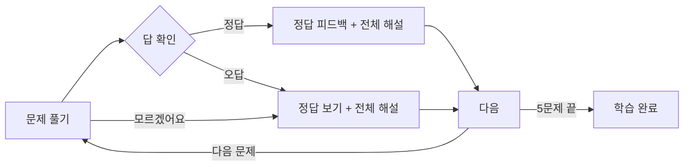
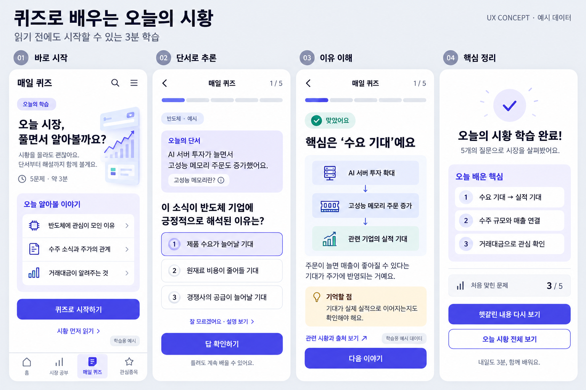
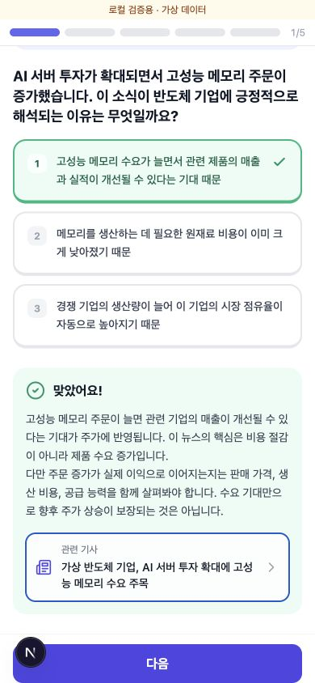
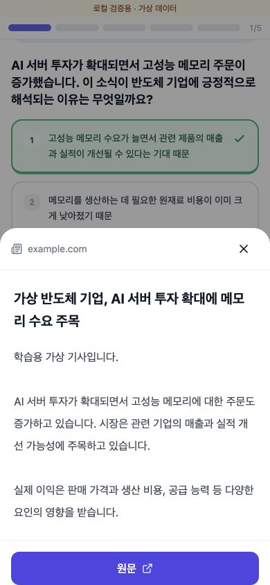
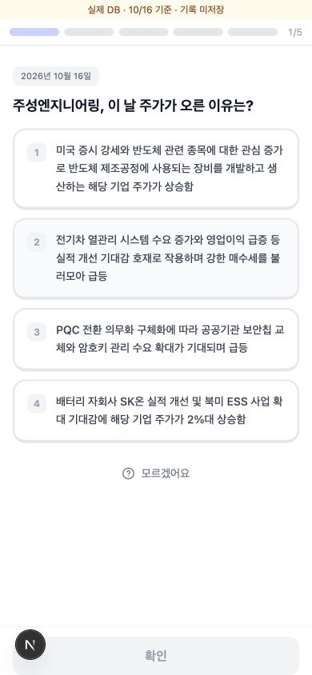
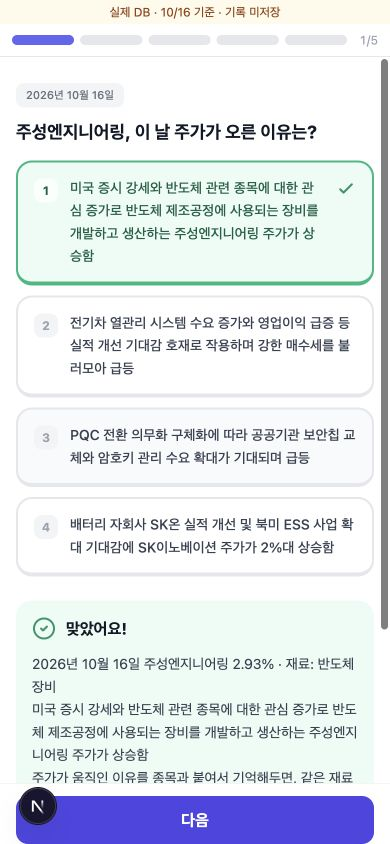

# 매일 퀴즈 레퍼런스와 UX 제안

조사일: 2026-10-18  
상태: 로컬 구현 · 타입 검사 및 테스트 데이터 검증 완료

## 개선 목표

시황을 미리 읽지 않은 사용자도 퀴즈를 풀면서 그날 시장을 이해할 수 있게 한다. 기본 흐름은 **시작 → 문제 풀기 → 해설 → 완료**로 단순하게 유지한다.

현재 확인한 퀴즈 화면과 API에는 시황 읽음 여부를 검사하는 제한이 없다. 다만 종목의 상승 이유를 바로 묻기 때문에 사전 지식이 필요한 경험에 가깝다. 각 문제에 이해에 필요한 짧은 단서를 넣는 것이 핵심이다.

## 기능별 레퍼런스

| 기능 | 서비스와 출처 | 확인한 방식 | 우리 서비스에 적용할 제안 |
| --- | --- | --- | --- |
| 풀면서 배우기 | [Brilliant 공식 FAQ](https://brilliant.org/faq/) | 상호작용 문제와 시각 자료를 탐색하면서 배우고 즉시 피드백을 받는다. | 문제 위에 시황 단서 1~2문장을 제공해 처음 보는 사용자도 추론할 수 있게 한다. |
| 답변 후 해설 | [Duolingo Explain My Answer](https://blog.duolingo.com/explain-my-answer-now-free/) | 사용자의 답변과 실수를 고려해 이유를 설명한다. | 정답과 오답 모두 같은 해설 화면에서 핵심 이유를 설명한다. 오답별 맞춤 해설은 후속 검토한다. |
| 금융 뉴스 퀴즈 | [Finimize Weekly News Quiz](https://finimize.com/content/weekly-news-quiz-19-10-11) | 금융 뉴스 기반의 주간 퀴즈를 제공했던 사례다. | 당일 시장의 주요 이슈를 문제 소재로 사용한다. |

Finimize 링크는 2019년 사례이며, 현재 동일한 퀴즈의 운영 여부는 확인하지 않았다. 위 서비스들이 모두 같은 흐름을 제공한다는 의미는 아니며, 적용안은 각 기능에서 얻은 아이디어를 조합한 제안이다.

## 듀오링고를 참고한 UX 흐름

[Duolingo의 답변 피드백](https://blog.duolingo.com/explain-my-answer-now-free/)을 참고해 문제를 푼 자리에서 바로 이유를 이해하도록 한다. 아래 화면 구성은 우리 서비스에 맞춘 제안이다. 해설은 별도 화면이 아니라 문제 아래에 표시한다. 학습 내용의 길이를 제한하지 않는다.

| 화면 | 핵심 내용 | 주요 행동 |
| --- | --- | --- |
| 시작 | 오늘 배울 주제, 5문제, 약 3분 | 시작하기 |
| 문제 | 짧은 시황 단서 + 질문 + 보기 3개 | 답 확인 / 모르겠어요 |
| 문제 하단 피드백 | 정답 표시 + 전체 해설. 화면 이동 없이 표시 | 계속하기 |
| 완료 | 오늘 배운 핵심 요약, 정답 수는 보조 정보 | 마치기 |

정답, 오답, ‘모르겠어요’ 모두 **문제 하단의 같은 피드백 영역**을 사용한다. 정답이면 ‘맞았어요’, 오답이면 ‘정답을 확인해봐요’, 모르겠어요를 누르면 ‘함께 알아봐요’라고 안내하고 이유를 설명한다. 이후 행동은 ‘다음’, 마지막 문제에서는 ‘완료’다.

상단에는 5칸 진행률을 표시하고 한 번에 한 문제만 보여준다. 시작 안내는 짧게 유지한다. 관련 기사는 답변을 확인한 후 해설에서 선택적으로 연다.

## 문항 예시

아래 내용은 실제 오늘 뉴스가 아닌 학습용 예시다.

- 단서: AI 서버 투자가 늘면서 고성능 메모리 주문도 증가했어요.
- 질문: 이 소식이 반도체 기업에 긍정적으로 해석된 이유는?
- 보기: 제품 수요 증가 기대 / 원재료 비용 감소 기대 / 경쟁사 공급 증가 기대
- 해설: 주문 증가가 매출 개선으로 이어질 수 있다는 기대가 반영된 거예요. 실제 실적으로 이어지는지도 확인해야 해요.

## 첫 구현 범위 제안

포함할 것은 짧은 단서, 보기 선택, ‘모르겠어요’, 공통 해설, 완료 요약이다. 별도 복습 모드, 중단 후 이어하기, 추가 보상, 맞춤 학습 경로는 우선 범위에서 제외한다.

데이터 기준은 정확하게 표시한다. 현재 출제는 최근 30일 자료도 활용하므로 과거 문제에는 해당 날짜를 표시하고, 휴장일에는 최근 거래일 기준임을 안내한다. 시황 자료가 없으면 기초 개념 문제임을 명시한다.

## 화면 시안

기존 흰색·인디고 색상을 유지한 이미지 생성 시안이다. 시안에는 복습 버튼 등 확장 요소가 포함되어 있지만, 첫 구현 범위와 흐름은 위 단순화안을 기준으로 검토한다.

## 모바일 문구와 아이콘 개선안

반복 제목과 안내 문장을 삭제하고 문제, 보기, 학습 이유에 글자를 집중한다. 닫기는 X, 진행 상태는 5칸 막대와 1/5, 원문 이동은 외부 링크 아이콘으로 표현한다. 기사 아이콘에는 ‘관련 기사’, 원문 버튼에는 ‘원문’이라는 짧은 이름을 함께 둔다.

버튼은 ‘답 확인하기 → 확인’, ‘계속하기 → 다음’으로 줄인다. **단서·질문·보기·해설 등 퀴즈 내용은 축약하지 않는다.** 내용은 이해에 필요한 길이로 유지하며 줄임표나 줄 수 제한으로 숨기지 않는다. 오답일 때는 정답 보기 전체와 해설을 표시한다. 색상에만 의존하지 않고 체크와 X, 피드백 문구를 함께 사용한다.

기사 읽기는 해설의 선택 동작으로 제공한다. 기사 패널에는 출처, 제목, 불러온 기사 본문, ‘원문’ 버튼을 두고 X로 닫으면 문제로 복귀한다. 본문 조회 실패 시 원문 링크를 제공한다. 아이콘 버튼은 구현 시 접근성 이름과 충분한 터치 영역을 제공한다.

이전 축약 시안은 퀴즈 내용까지 줄여 폐기했다. 구현에는 주변 UI만 간결하게 만드는 원칙을 적용한다.

## 다음 기능 조사에도 사용할 기록 형식

기능마다 `개선 목표 → 레퍼런스와 출처 → 적용할 점 → 간단한 UX 흐름 → 첫 구현 범위` 순서로 정리한다. 확인한 서비스의 기능과 새로 제안하는 기능을 구분한다.

## 로컬 구현과 검증

- 기존 질문·보기·지문·해설을 보존하고, 결과 화면의 정답 줄임표와 내 답 줄 수 제한도 제거했다.
- 저장된 회사 설명이 있는 문항에는 사업 맥락을 추가한다. 없는 내용을 생성해서 채우지는 않는다.
- 관련 기사 제목에 해당 종목명이 확인되고 HTTP/HTTPS URL이 유효할 때만 기사 버튼을 표시한다.
- 기존 기사 API로 본문을 불러온다. 로딩 실패 시 원문 링크를 유지한다.
- 390px 모바일 테스트 데이터로 정답, 오답, 모르겠어요, 5문제 완료, 기사 열기와 닫기, 본문 조회 실패를 확인했다.
- TypeScript 검사와 diff 공백 검사를 통과했다. 기존 버전과 1,250개 출제 결과를 비교해 새 맥락·기사 필드 외의 질문, 보기, 지문, 해설, 정답이 동일함을 확인했다.
- 실제 앱은 로그인이 필요해 실제 계정의 기록 저장과 실제 기사 조회는 별도 확인이 필요하다. 독립 미리보기는 가상 데이터이며 실제 DB에 기록하지 않는다.

## 실제 시황 검증 후 수정

[실제 시황 연결 검증](./daily-quiz-live-verification.md)에서 실제 DB와 기사 본문을 확인했다. 두산과 두산에너빌리티처럼 이름이 겹치는 종목의 출처 혼동을 차단하고, 기존 보기·지문 생성 단계의 글자 수 제한을 제거했다. 따라서 앞선 1,250개 비교 결과는 이 추가 수정 이전의 검증 기록이다.

## 종목명 표시 원칙

- 상승 이유를 고르는 보기는 빈칸 없이 자연스럽게 읽히는 문장으로 제공한다. 보기의 대상 회사는 ‘해당 기업’으로 표현할 수 있지만 관계사명이나 상승 이유를 지우지 않는다.
- 종목을 맞히는 문제의 지문과 배경 설명에서만 이름을 가린다. 이미 종목을 알려준 문제의 배경 설명에서는 실제 이름을 유지한다.
- 답 확인 또는 ‘모르겠어요’를 누르면 보기·지문·배경 설명에 원래 이름을 표시한다. 원문을 별도로 보관해 순서와 정답 위치를 바꾸지 않고 전환한다.
- 짧은 종목명이 다른 이름 안에 포함됐다는 이유로 일부만 치환하지 않는다. 예를 들어 SK온을 ‘○○○온’으로 만들지 않는다.

실제 DB 스냅샷으로 1,200개 시드의 보기·정답 위치와 원문 복원을 검증했다. 모바일 화면에서도 주성엔지니어링 문제의 확인 전·후 전환과 SK온 보존을 확인했다.

### 2026-10-18 출제 유형 조정

- 사용자 요청으로 거래대금·회전율·개념 유형을 제거했다.
- 남은 유형: 상승 이유, 이유로 종목 맞히기, 종목의 재료, 재료로 종목 맞히기, 같은 테마 종목, 사업 설명으로 종목 맞히기.
- 실제 데이터로 최대 5문제를 구성한다. 데이터가 부족하면 개념 문제로 보충하지 않으며, 0문제일 때는 시작을 비활성화한다.
- 실제 DB 스냅샷으로 200개 시드를 확인: 모두 5문제이고 제거된 유형은 출제되지 않았다. 로컬 3002 API에도 반영했다.
